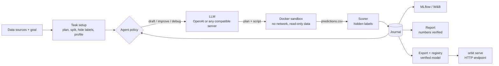

# orbit

**An LLM agent that designs, runs and compares ML experiments on its own, in a sandbox, with scores you can trust.**

<a href="https://drive.google.com/file/d/1DgKU5c7CR_R0DuUr6vsXL1LDRWQ4tIfS/view?usp=sharing">
  
</a>

Describe a prediction problem in plain language and point orbit at the data: a CSV, an Excel
workbook, a folder of tables and notes, a zip file or a URL. orbit asks an LLM to write a complete
training script, runs it in a locked-down Docker container, scores the predictions against labels
the script never sees, and decides what to try next: a new approach, a fix for a crash, or a
focused improvement to the current best. Every experiment is logged to MLflow (or Weights & Biases),
the run ends with a short written report whose numbers are checked against the actual results, and
the best model can be registered and served over HTTP.

```
$ orbit run examples/data/breast_cancer.csv --target diagnosis --steps 15
$ orbit run my_task/ --goal "Predict each house's sale price" --eval "RMSE between log prices"
$ orbit run https://example.com/train.csv --goal "Predict who will churn"
```

## What you get

- **Honest scores.** Experiments are ranked by cross-validation on rows the generated code never
  sees labels for; a held-out test split is scored once, for the winner. The report shows the
  spread across folds and says whether the gain over the baseline is larger than that spread, so a
  gain inside the noise is visible.
- **Isolation.** Generated code only ever runs in a fresh, locked-down container.
- **Any LLM.** Plain chat completions work with OpenAI, a local vLLM server, Ollama or any
  OpenAI-compatible endpoint; no tool calling is needed.
- **Problems in plain language.** State the goal and how to judge it, give any number of data
  sources, optionally name the target; orbit works out the rest and checks it against the files.
- **A report you can read.** `report.md` and a standalone `report.html` with charts, the
  leaderboard, failures and the best script; the narrative is reviewed against the data and falls
  back to a deterministic template if it cannot be made consistent.
- **Tracking.** One MLflow experiment per problem, a nested run per experiment, traces of every
  search step, host and per-container resource use.
- **Models you can use.** The best approach is refit on all labeled rows, verified, registered in
  the MLflow model registry and served with `orbit serve`.

## How it works



- **Search.** Experiments form a tree. orbit drafts a few independent solutions, then alternates
  between repairing failed ones (using their stack traces) and refining the best one. Budgets cap
  steps, wall time and tokens; `--patience` stops a search that has stopped improving.
- **Honest scores.** The sandbox only gets training data and *unlabeled* rows. Those rows mix
  validation rows (used to rank experiments; by default 5-fold cross-validation on small datasets,
  forward-chaining folds with `--time-col` or `--time-order`) and a test split (scored once, for the final winner).
  The generated code cannot see either set of labels, so it cannot overfit or misreport its score.
- **Isolation.** Each experiment runs in a fresh container: no network, read-only root filesystem,
  all capabilities dropped, CPU/memory/process limits and a timeout. The data is mounted
  read-only. gVisor is supported for stronger isolation.
- **Helpers.** Generated scripts can use a small bundled helper (`data/orbit_helpers.py`, numpy and
  pandas only): `d = load()` gives numeric feature frames with text columns encoded consistently
  for train and test, NaN-filled copies and the target, and `d.save(pred)` validates and writes
  `predictions.csv`. The raw CSVs and extra tables stay available for custom feature engineering;
  the helper holds no labels.
- **Reusable model.** After the search, the best approach is refit on all labeled rows and saved as
  one pickled scikit-learn pipeline that takes raw feature rows. It is accepted only if an
  allow-list scan of the pickle passes and it reproduces its predictions after being reloaded in
  the sandbox; see [Model export](docs/DESIGN.md#model-export).
- **Traceable.** Each experiment keeps its prompt, response, script, logs and score, in the run
  folder and in the tracker.

## Quickstart

Requirements: Python 3.11+, [uv](https://docs.astral.sh/uv/), Docker.

```bash
git clone https://github.com/dsadulla1/orbit-ml && cd orbit-ml
uv sync
cp .env.example .env                       # add OPENAI_API_KEY, or point it at a local server (below)

docker compose --env-file .env -f docker/compose.yaml build sandbox
docker compose --env-file .env -f docker/compose.yaml up -d mlflow   # tracking UI on :5000

uv run orbit doctor                        # checks LLM, Docker, sandbox image, tracker
uv run orbit run examples/data/breast_cancer.csv --target diagnosis --steps 15
uv run orbit results runs/<the new run folder>
```

Open `runs/<run>/report.html` in a browser, or the MLflow UI at http://localhost:5000. To serve
the model afterwards, see [docs/mlflow.md](docs/mlflow.md#serving-a-model).

Each run writes a folder under `runs/`:

```
runs/20261001-120000-breast_cancer/
  report.md          summary, splits, leaderboard, run stats
  report.html        the same as one standalone page: charts, leaderboard, best script
  journal.json       every experiment: stage, parent, plan, score, error, tokens
  task.json          metric, baseline, data profile
  input/             train.csv + unlabeled test.csv (+ orbit_meta.json, orbit_helpers.py), or fold_1/ ... fold_k/
  hidden/labels.csv  validation/test labels (never mounted)
  nodes/007/         solution.py, prompt.md, response.md, stdout.txt, stderr.txt, predictions.csv
  export/            the verified model.pkl and the export attempts
  tracking.json      where the run lives in MLflow
```

## Describing a problem

`DATA` can be any mix of CSV/TSV files, Excel workbooks (`.xlsx`; each sheet with data becomes a
table, old `.xls` files must be saved as `.xlsx` or CSV first), folders, zip files and `http(s)`
URLs; text files such as a data description are read and shown to the model. `orbit explore` takes
the same sources, so you can check what orbit finds before a run.

- Delimiter (comma, semicolon, tab or pipe), text encoding (UTF-8 with or without a BOM, otherwise
  Windows-1252/Latin-1) and decimal comma are detected per file; `.tsv` files are always tab
  separated. When a file is not plain comma/UTF-8, a "read X with delimiter ';'" line appears in the
  setup output and the report.
- Zip files may contain folders and further zip files (up to 6 levels deep, 20 archives and 2 GB
  in total). Anything skipped is listed with the reason; for very deep or large nesting, unzip it
  and pass the folder.
- Data profiles in `orbit explore` and in the prompt that picks the table and target use every row
  of a table up to 100,000 rows. Larger tables are profiled on a seeded random sample of 100,000
  rows (never just the top of the file), and the output says so. The training data itself is
  always read in full.
- When several tables contain the target column, the setup output names the one that was used,
  why, and the other candidates with their row counts.

- `--drop COL` removes a column of the main table everywhere (repeat the option or separate names
  with commas; spelling must match exactly). Use it for columns that leak the target or are not
  known when a prediction is made, such as the length of a call in a call-campaign dataset, which
  is only known after the call. The column is absent from what the generated code sees, from the
  profile, the exported model and the served endpoint, which therefore does not ask for it; the
  setup output, report and MLflow run record that it was dropped. The target and the id column
  cannot be dropped; dropping the `--time-col` column is fine (it still orders the rows). Other
  tables are not touched.
- `--goal` states the problem in plain language and `--eval` says how to judge it, as a metric
  name or in words ("RMSE between log prices").
- Leave out `--target` and orbit asks the LLM which table and column to predict, then checks its
  answer against the files. When several tables hold the target (several versions of one dataset, for
  example) the setup output says which was used and why; pick another with `--table NAME` (a file
  name or part of it), for `explore` as well as `run`.
- Tables that don't hold the target are available to the generated code under `data/extra/`
  (read-only), so they can be joined in. A table that contains the target column is ignored,
  because the generated code could read the labels from it (combine such files into the training
  table first), and so is a table that only repeats the training columns without the target.
  Folders named `runs`, `hidden` or `mlruns` and earlier orbit runs are never copied.
- Everything you point at is copied into the run folder. URLs are fetched with the host's network
  access, so only use sources you trust.
- Run folders are named `<timestamp>-<name>`; set the name with `--name`. A setup that fails leaves
  no folder behind.

**Validation.** By default rows are split at random. For forecasting-style problems pass
`--time-col COL`: rows are ordered by that column (dates or numbers; rows without a usable value
are dropped and noted), the latest rows become the test split, and validation rows are always later
than the rows used for training (one split, or forward-chaining folds that train on everything
before each validation block). The column stays available to the generated code as a feature
unless you also `--drop` it.
If the rows are already in time order but there is no date column, pass `--time-order` instead: the
file order is the time order, the same layout applies and no column is added (the two options cannot
be combined). `--folds K` sets the number of folds (1 = a single split); datasets above about
10,000 rows use a single split by default because every fold costs a sandbox run per experiment,
and a single split has no spread across folds, so orbit says so in the setup output and the report.

When the data is validated at random, orbit adds non-blocking notes to the setup output and the
report (files of at least 500 rows only; a column you `--drop` is not considered): a column that looks like a date (named like one, or text
that parses as dates), and a target whose rate or mean changes along the file, both of which mean
random validation is optimistic for later periods. The report also lists the rows and target rate
(or mean and standard deviation) of the training rows, the validation folds and the test split, the
baseline on each, and the gains over them. When the target rate or mean of the test split differs
clearly from validation (for a binary target: by more than a factor of 1.5 and 0.03; for a
multiclass target: a class share by more than 0.10; for a numeric target: by more than half a
standard deviation), the report warns that scores and baselines differ between the two, compares
gains over each baseline, and does not read the gap as overfitting. Every setup note appears in
`report.md` under "Setup notes" and in the HTML report. The narrative compares the gain over the
baseline (not the score) with the spread across folds; a statement the facts contradict is
rejected and rewritten, and the template says so in plain words when the gain is not larger than
the spread.

**Metrics.** `roc_auc`, `pr_auc` and `log_loss` (binary), `accuracy`, `balanced_accuracy`,
`f1_macro`, `rmse`, `rmsle` (RMSE of log1p values, targets >= 0), `mae`, `r2`. By default orbit
picks `roc_auc` for binary targets, `accuracy` for multiclass and `rmse` for regression. Each run
also reports a baseline, the best constant prediction for the metric, as a reference.

## Commands

| Command | What it does |
|---|---|
| `orbit explore DATA... [-t TARGET] [--drop COL]` | List the tables and documents found in the sources and print the data profile the agent will see, without the dropped columns (no LLM call) |
| `orbit run DATA... [-t TARGET] [--goal "..."] [--eval "..."] [--steps N] [--minutes M] [--table NAME] [--folds K] [--time-col COL] [--time-order] [--drop COL] [--patience N] [--timeout SECONDS] [--name NAME] [--experiment NAME] [--no-export]` | Solve a problem: run a search, write the report, export and register the best model |
| `orbit results RUN_DIR [--json] [--html FILE]`, `orbit results --mlflow RUN_ID` | Everything about a run: best model, scores, every experiment; as a table, JSON or HTML, from the run folder or straight from MLflow |
| `orbit compare RUN_DIR` | Table of every experiment in a run, best first |
| `orbit summarize RUN_DIR [--no-llm]` | Rewrite `report.md` (LLM narrative or deterministic template) |
| `orbit export RUN_DIR [--model-name NAME] [--no-register] [--force-champion] [--attempts N] [--hint TEXT] [--reuse]` | Refit a run's best experiment on all labeled rows, verify it and register it in the MLflow model registry; `--hint` gives the LLM extra guidance when an export failed; `--reuse` registers the run's existing verified export again (no LLM, no Docker) |
| `orbit models` | List the registered MLflow models with their latest version and the `champion` version's metric and scores |
| `orbit serve MODEL [--version N \| --alias NAME] [--port P]`, `orbit serve --list`, `orbit serve --stop NAME\|all` | Serve a registered model (`champion` by default) in a dedicated Docker container on 127.0.0.1 |
| `orbit predict ENDPOINT ROWS.csv [--out FILE] [--keep-columns] [--strict]` | Score a CSV of raw feature rows against a running endpoint (a URL, or the name of a served model); a model name also checks the CSV first, and `--strict` refuses text values not seen in training |
| `orbit experiments` | List the MLflow experiments (one per problem) with their number of runs and the time of the latest run |
| `orbit doctor` | Check the LLM endpoint, Docker, the sandbox image and the tracker |

`orbit <command> --help` lists every option.

## MLflow, registry and serving

With MLflow (the default tracker) each problem is its own experiment, runs in it are tagged and
comparable, every search step is traced, and the host's and each container's resource use is
recorded. The best model is registered with a `champion` alias and `orbit serve` turns it into an
HTTP endpoint:

```bash
docker compose --env-file .env -f docker/compose.yaml build serve   # once
uv run orbit serve my-model
uv run orbit predict my-model new_rows.csv --out scored.csv
uv run orbit serve --stop all
```

[docs/mlflow.md](docs/mlflow.md) covers experiments, traces, system metrics, the registry's
`champion` rule and serving in detail, including what runs where and why the serving container is
separate from the experiment sandbox.

## Using a local model (vLLM)

`docker/compose.yaml` includes a `vllm` service, by default Qwen3-Coder-30B-A3B (4-bit W4A16) split
across two 12 GB GPUs:

```bash
docker compose --env-file .env -f docker/compose.yaml --profile local-llm up -d vllm
```

```ini
# .env
ORBIT_LLM_BASE_URL=http://localhost:8000/v1
ORBIT_LLM_API_KEY=EMPTY
ORBIT_LLM_MODEL=orbit-coder
ORBIT_LLM_TEMPERATURE=0.2
```

See [docker/README.md](docker/README.md) for GPU prerequisites, model sizing and hardening.

## Configuration

All settings come from environment variables (or `.env` in the working directory).

| Variable | Default | Purpose |
|---|---|---|
| `OPENAI_API_KEY` / `ORBIT_LLM_API_KEY` | | API key (`EMPTY` works for local servers) |
| `ORBIT_LLM_BASE_URL` | OpenAI | Any OpenAI-compatible endpoint |
| `ORBIT_LLM_MODEL` | `gpt-5-mini` | Model name |
| `ORBIT_LLM_TEMPERATURE`, `ORBIT_LLM_MAX_TOKENS` | unset | Only sent when set |
| `ORBIT_SANDBOX_IMAGE` | `orbit-sandbox:latest` | Image that runs experiments |
| `ORBIT_SANDBOX_CPUS` / `ORBIT_SANDBOX_MEMORY` | `4` / `8g` | Per-experiment limits |
| `ORBIT_SANDBOX_TIMEOUT` | `600` | Seconds for one experiment (`--timeout`), shared by its cross-validation folds: each fold's run gets the limit divided by the number of folds, at least 30 s |
| `ORBIT_SANDBOX_RUNTIME` | unset | e.g. `runsc` for gVisor |
| `ORBIT_SERVE_IMAGE` / `ORBIT_SERVE_MEMORY` | `orbit-serve:latest` / `4g` | Image and memory limit of `orbit serve` containers |
| `MLFLOW_TRACKING_URI` | MLflow default | e.g. `http://localhost:5000` |
| `ORBIT_EXPERIMENT` | named after the problem | MLflow experiment / W&B project to log to (`--experiment` wins) |
| `ORBIT_TRACING` | on | `off` (or `0`, `false`, `no`) disables MLflow traces |
| `ORBIT_SYSTEM_METRICS` | on | `off` (or `0`, `false`, `no`) disables host system metrics on the MLflow parent run |
| `WANDB_API_KEY` | unset | If set, W&B becomes the default tracker (`uv sync --extra wandb`) |

`--tracker auto|mlflow|wandb|none` overrides the tracker choice per run.

## Security model

Generated code is untrusted. orbit never runs it on the host, and the experiment sandbox has no
network and no access to labels or credentials. All logging happens in the orchestrator.

- Anyone who can run orbit can talk to the Docker daemon, which is root-equivalent on the host.
- MLflow and the model endpoints have no authentication and are published on 127.0.0.1 only; put
  your own proxy in front before exposing them.
- A registered model is a pickle written by generated code. orbit scans it against an allow-list
  and reloads it in the sandbox before accepting it, and it is only ever loaded inside the serving
  container, which has no access to MLflow's data. The scan is defence in depth, not a guarantee.
- URL sources are fetched with the host's network access.

Details are in [docs/DESIGN.md](docs/DESIGN.md) and [docker/README.md](docker/README.md).

## Limitations

- The quality of the search depends on the LLM. Generated scripts often fail (orbit repairs them
  from their stack traces, but failures use up budget), and small local models fail more.
- The default validation is random; use `--time-col` (or `--time-order` for a file already in time
  order) when later rows must be predicted from earlier ones. Small datasets give noisy scores: look at the spread across folds.
- Cross-validation runs every experiment once per fold, and the experiment's time limit is shared by
  the folds (3 folds under the default 600 s leave 200 s per run), so heavy models need a larger
  `--timeout`.
- orbit targets one labeled table (plus extra tables to join). Several labeled files with the same
  schema are not combined for you.
- The exported model is refit on every labeled row, so its own predictions on those rows are not a
  performance estimate: use the stored cross-validation and test scores.
- Excel is read as `.xlsx` only; the data must be tabular.

## Querying runs from an AI assistant (MCP)

MLflow ships an MCP server, so assistants such as Claude Code or Cursor can browse and compare
orbit runs. See [docs/mcp.md](docs/mcp.md).

## Development

See [CONTRIBUTING.md](CONTRIBUTING.md). In short: `uv sync`, then `uv run pytest`; the tests replace
the LLM with a scripted fake and run trusted fixture scripts in a subprocess, so they need neither
an API key nor Docker for most of the suite.

## Related work

orbit's search loop (draft, debug, improve over a tree of solutions) is inspired by
[AIDE](https://github.com/WecoAI/aideml) ([paper](https://arxiv.org/abs/2502.13138)). orbit is an
independent, much smaller implementation focused on sandboxed execution, held-out scoring and
experiment tracking.

## License

MIT
