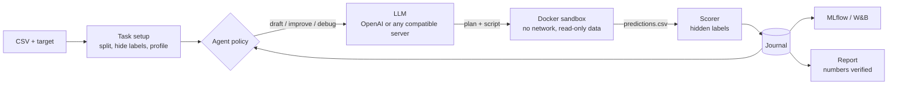

# orbit

**An LLM agent that designs, runs and compares ML experiments on its own, in a sandbox, with scores you can trust.**

Point orbit at a CSV and a target column. It asks an LLM to write a complete training
script, runs that script in a locked-down Docker container, scores the predictions
against labels the script never sees, and decides what to try next: a new approach,
a fix for a crash, or a focused improvement to the current best. Every experiment is
logged to MLflow (or Weights & Biases), and the run ends with a short written report
whose numbers are checked against the actual results.

```
$ orbit run examples/data/breast_cancer.csv --target diagnosis --steps 15
```

## How it works



- **Search.** Experiments form a tree. orbit drafts a few independent solutions, then
  alternates between repairing failed ones (using their stack traces) and refining the best
  one. Budgets cap steps, wall time and tokens.
- **Honest scores.** The sandbox only gets the training data and *unlabeled* rows. Those rows
  mix validation rows (used to rank experiments, by default with 5-fold cross-validation on small
  datasets) and a test split (scored once, for the final winner). The generated code can't see either set of labels, so it can't overfit or
  misreport its own score.
- **Isolation.** Each experiment runs in a fresh container: no network, read-only root
  filesystem, all capabilities dropped, CPU/memory/process limits and a timeout. The dataset is
  mounted read-only. gVisor is supported for stronger isolation.
- **Any model.** orbit uses plain chat completions (a plan plus one Python code block), so it works
  with OpenAI, a local [vLLM](https://docs.vllm.ai) server, Ollama, or any other
  OpenAI-compatible endpoint. No tool-calling support is required.
- **Traceable.** Each experiment keeps its prompt, response, script, stdout/stderr and score,
  in the run folder and in the tracker.

## Quickstart

Requirements: Python 3.11+, [uv](https://docs.astral.sh/uv/), Docker.

```bash
git clone https://github.com/dsadulla1/orbit-ml && cd orbit-ml
uv sync
cp .env.example .env                       # add OPENAI_API_KEY

docker compose --env-file .env -f docker/compose.yaml build sandbox
docker compose --env-file .env -f docker/compose.yaml up -d mlflow   # optional: tracking UI on :5000

uv run orbit doctor                        # checks LLM, Docker, sandbox image, tracker
uv run python examples/make_datasets.py    # optional: regenerate the example CSVs
uv run orbit run examples/data/breast_cancer.csv --target diagnosis --steps 15
```

Each run writes a folder under `runs/`:

```
runs/20261001-120000-breast_cancer/
  report.md          summary, leaderboard, run stats
  journal.json       every experiment: stage, parent, plan, score, error, tokens
  task.json          metric, baseline, data profile
  input/             train.csv + unlabeled test.csv, or fold_1/ ... fold_k/ with cross-validation
  hidden/labels.csv  validation/test labels (never mounted)
  nodes/007/         solution.py, prompt.md, response.md, stdout.txt, stderr.txt, predictions.csv
```

## Commands

| Command | What it does |
|---|---|
| `orbit explore DATA -t TARGET` | Print the data profile the agent will see |
| `orbit run DATA -t TARGET [--metric M] [--steps N] [--minutes M] [--folds K] [--goal "..."]` | Run a search |
| `orbit compare RUN_DIR` | Table of every experiment in a run, best first |
| `orbit summarize RUN_DIR [--no-llm]` | Rewrite `report.md` (LLM narrative or deterministic template) |
| `orbit doctor` | Check the LLM endpoint, Docker, the sandbox image and the tracker |

Metrics: `roc_auc`, `pr_auc` and `log_loss` (binary), `accuracy`, `balanced_accuracy`, `f1_macro`, `rmse`,
`rmsle` (RMSE of log1p values, targets >= 0), `mae`, `r2`.
By default orbit picks `roc_auc` for binary targets, `accuracy` for multiclass and `rmse` for
regression. Each run also reports a feature-free baseline for reference.

## Using a local model (vLLM)

`docker/compose.yaml` includes a `vllm` service, by default Qwen3-Coder-30B-A3B (4-bit W4A16) split
across two 12 GB GPUs:

```bash
docker compose --env-file .env -f docker/compose.yaml --profile local-llm up -d vllm
```

```ini
# .env
ORBIT_LLM_BASE_URL=http://localhost:8000/v1
ORBIT_LLM_API_KEY=EMPTY
ORBIT_LLM_MODEL=orbit-coder
ORBIT_LLM_TEMPERATURE=0.2
```

See [docker/README.md](docker/README.md) for GPU prerequisites, model sizing and hardening.

## Configuration

All settings come from environment variables (or `.env` in the working directory).

| Variable | Default | Purpose |
|---|---|---|
| `OPENAI_API_KEY` / `ORBIT_LLM_API_KEY` | | API key (`EMPTY` works for local servers) |
| `ORBIT_LLM_BASE_URL` | OpenAI | Any OpenAI-compatible endpoint |
| `ORBIT_LLM_MODEL` | `gpt-5-mini` | Model name |
| `ORBIT_LLM_TEMPERATURE`, `ORBIT_LLM_MAX_TOKENS` | unset | Only sent when set |
| `ORBIT_SANDBOX_IMAGE` | `orbit-sandbox:latest` | Image that runs experiments |
| `ORBIT_SANDBOX_CPUS` / `ORBIT_SANDBOX_MEMORY` | `4` / `8g` | Per-experiment limits |
| `ORBIT_SANDBOX_TIMEOUT` | `600` | Seconds per experiment |
| `ORBIT_SANDBOX_RUNTIME` | unset | e.g. `runsc` for gVisor |
| `MLFLOW_TRACKING_URI` | MLflow default | e.g. `http://localhost:5000` |
| `WANDB_API_KEY` | unset | If set, W&B becomes the default tracker (`uv sync --extra wandb`) |

`--tracker auto|mlflow|wandb|none` overrides the tracker choice per run.

If the MLflow server is unreachable, orbit logs a warning per call and carries on. It sets short
HTTP retry defaults (`MLFLOW_HTTP_REQUEST_MAX_RETRIES=1`, `MLFLOW_HTTP_REQUEST_TIMEOUT=15`) so an
outage costs seconds per experiment, not minutes; set those variables yourself to override.

## Querying runs from an AI assistant (MCP)

MLflow ships an MCP server, so assistants such as Claude Code or Cursor can browse and
compare orbit runs. See [docs/mcp.md](docs/mcp.md).

## Security model

Generated code is untrusted. orbit never runs it on the host, and the sandbox has no
network and no access to labels or credentials. All logging happens in the orchestrator.
Note that anyone who can run orbit can talk to the Docker daemon, which is root-equivalent on
the host. Details are in [docs/DESIGN.md](docs/DESIGN.md) and [docker/README.md](docker/README.md).

## Development

```bash
uv sync
uv run pytest
```

The tests replace the LLM with a scripted fake and run trusted fixture scripts in a
subprocess, so they need neither an API key nor Docker.

## Related work

orbit's search loop (draft, debug, improve over a tree of solutions) is inspired by
[AIDE](https://github.com/WecoAI/aideml) ([paper](https://arxiv.org/abs/2502.13138)). orbit is an
independent, much smaller implementation focused on sandboxed execution, held-out scoring and
experiment tracking.

## License

MIT
